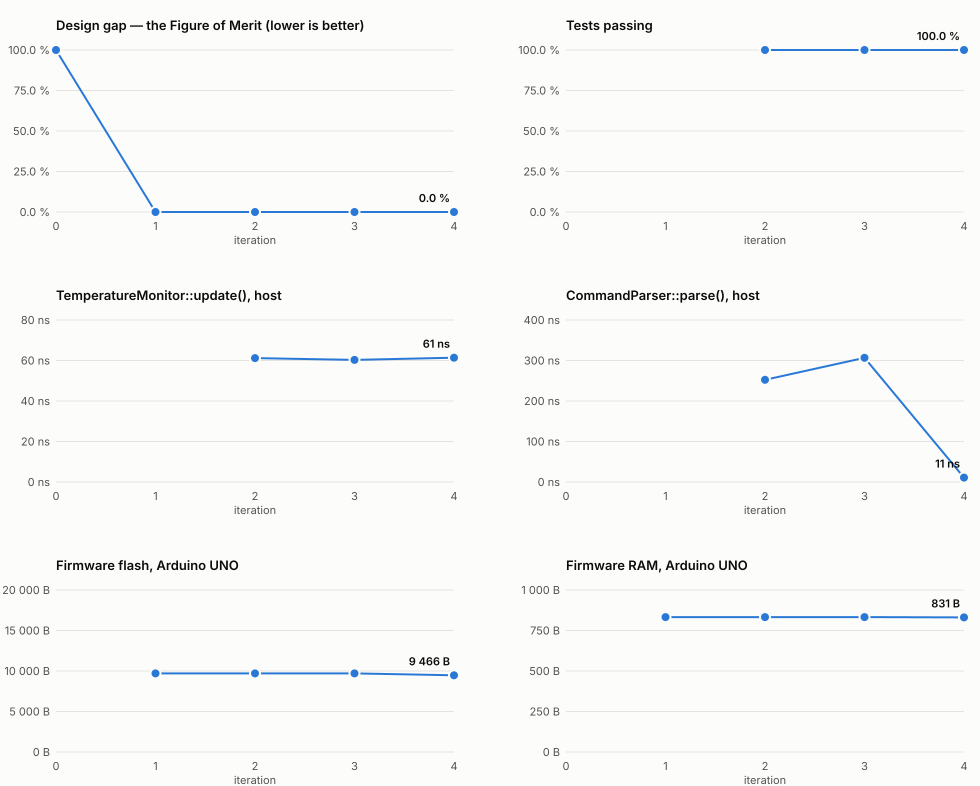

# Temperature alarm — Arduino, C++ from a UML model, WebSerial + Dexie website

An Arduino reads a DHT11 temperature sensor, sounds a buzzer when the temperature leaves the
threshold, and shows it on an I2C LCD. A website connects over WebSerial, stores every reading
in the browser with Dexie (IndexedDB), draws it, and changes the threshold.

Built the way assignment 1 was: **model first, then code, then deterministic verification**.
The C++ is checked against its UML design by `tools/verify.py` (libclang + a traced run, no
AI), and every iteration's Figure of Merit is recorded in [`fom/`](fom/README.md).



## What is where

```
arduino/
  model/                    1. the design, as mermaid: class, state machine, two scenarios
  diagrams/input/*.drawio      drawn from model/ by tools/generate_diagrams.py
  impl/                     2. the C++ classes (portable: avr-gcc C++11 and host C++20)
    include/tempalarm/         one header per class: what the verifier compares
    src/                       the code; hal_host.cpp = simulated board for the host
    scenarios/                 one program per sequence diagram, run in a traced build
    tests/  bench/             doctest unit tests, benchmarks
  reports/                  3. verification reports (generated)
  temperature_alarm/        the Arduino sketch
    temperature_alarm.ino      creates the objects and runs them — no behaviour
    hal_arduino.cpp            the only file that touches DHT11, LCD and Serial
    board_config.h             pins, LCD address, start threshold
    src/                       copy of impl/ (generated by tools/sync_firmware.py)
  dashboard/                the website (index.html, js/, css/, tests/)
  fom/                      Figure of Merit history, chart and table (generated)
  tools/                    generate_diagrams.py, sync_firmware.py, fom.py
  process/                  specification and plan
```

## Single responsibility, end to end

| Firmware class | Its one job |
|---|---|
| `TemperatureMonitor` | one measurement cycle, and the alarm state machine (Normal / Alarming / Sensor fault) |
| `CommandHandler` | carry out the website's commands |
| `TemperatureSensor` · `Buzzer` · `LcdDisplay` · `SerialLink` | one piece of hardware each |
| `Threshold` | the allowed range: classify a value, validate a change |
| `IntervalTimer` | when the next measurement is due |
| `CommandParser` · `MessageFormatter` | read incoming lines · write outgoing lines |

| Website module | Its one job |
|---|---|
| `protocol.js` | what the lines mean (pure) |
| `line-splitter.js` | chunks → lines (pure) |
| `serial-connection.js` · `simulated-device.js` | move lines to/from the Arduino · a stand-in device |
| `reading-store.js` | Dexie: store and query readings and threshold changes |
| `temperature-chart.js` · `dashboard-view.js` | draw the chart · update the page |
| `app.js` | create the parts and connect them |

Hardware is reached only through the free functions of
[`hal.hpp`](impl/include/tempalarm/hal.hpp) — linked to `hal_arduino.cpp` on the board and to a
simulation on the host — so every class is tested and verified without hardware.

## Wiring (Arduino UNO; Mega: SDA 20, SCL 21)

| Part | Pin |
|---|---|
| DHT11 data | D2 (with its pull-up; 3-pin modules have one) |
| Buzzer + (active or passive) | D8 (− to GND) |
| LCD I2C SDA / SCL | A4 / A5, at address 0x27 (0x3F on some modules: `board_config.h`) |

## Use it

1. **Firmware.** Arduino IDE: install *DHT sensor library* (Adafruit) and *LiquidCrystal I2C*
   (Frank de Brabander), open `temperature_alarm/temperature_alarm.ino`, upload. Or:
   `arduino-cli compile --fqbn arduino:avr:uno arduino/temperature_alarm` and `upload -p COM3`.
2. **Website.** `python -m http.server 8000 -d arduino/dashboard` (VS Code task *Arduino: serve
   the dashboard*), open <http://localhost:8000> in Chrome or Edge, **Connect Arduino**, pick the
   port. Close the Arduino IDE's Serial Monitor first: only one program can open the port.
   No board? **Try without hardware** (or `?demo`) runs a simulated device with the same protocol.
3. **Change the threshold** in the form; the device answers `TH,…` (shown in green) or
   `ERR,INVALID`. It is kept until the board restarts; the website remembers the last one.

## Verify and measure

```sh
python arduino/tools/generate_diagrams.py   # model/*.mmd -> diagrams/input/*.drawio (+ round-trip check)
python tools/verify.py arduino              # the four reports in reports/
python arduino/tools/fom.py "what changed"  # one iteration: verify, test, benchmark, build firmware
```

(`.venv/Scripts/python.exe` on Windows, `.venv/bin/python` elsewhere.) After a change in `impl/`,
`python arduino/tools/sync_firmware.py` refreshes the sketch's copy (`fom.py` does it too;
`--check` fails if it is stale).

**Figure of Merit: the design gap** = 100 % − the mean alignment of the four reports. 0 % means
the C++ is exactly the design. Tracked beside it: unit tests passed (C++ and JavaScript), the
`update()` and `parse()` benchmarks, and the firmware's flash and RAM on an UNO, so a change that
keeps the design but costs speed or memory still shows.

| Iteration | What happened | Gap | Notable |
|--:|---|--:|---|
| 0 | design only | 100 % | no code yet |
| 1 | first C++ core, scenarios, sketch | 0 % | 9 702 B flash, 833 B RAM |
| 2 | unit tests and benchmarks | 0 % | 46/46; `parse()` 252 ns |
| 3 | website and its tests | 0 % | 18/18 |
| 4 | strict hand-written number parser | 0 % | `parse()` 307 → 11 ns, flash −236 B |

Benchmarks run on the host with the simulated board, so they track relative change between
iterations, not the 16 MHz Arduino's absolute speed.
