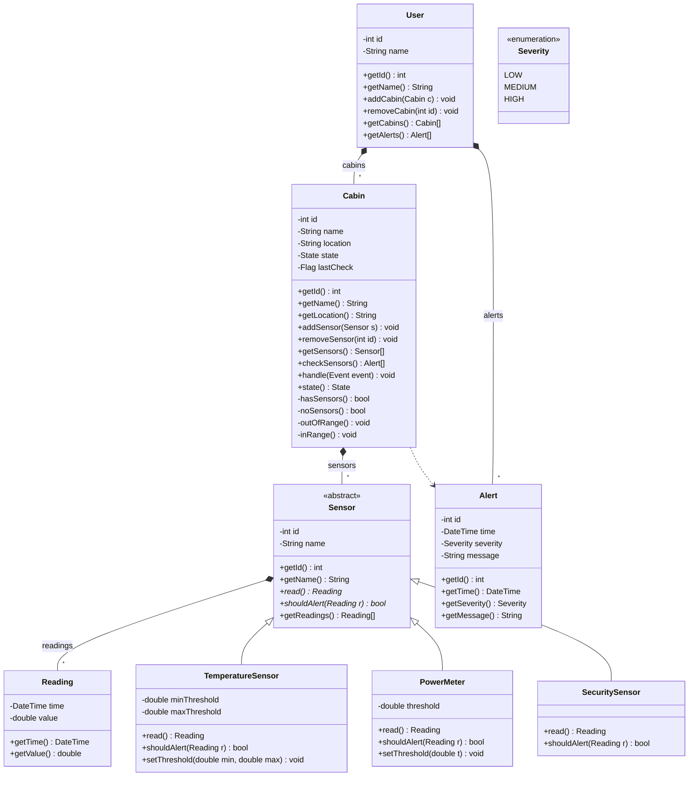
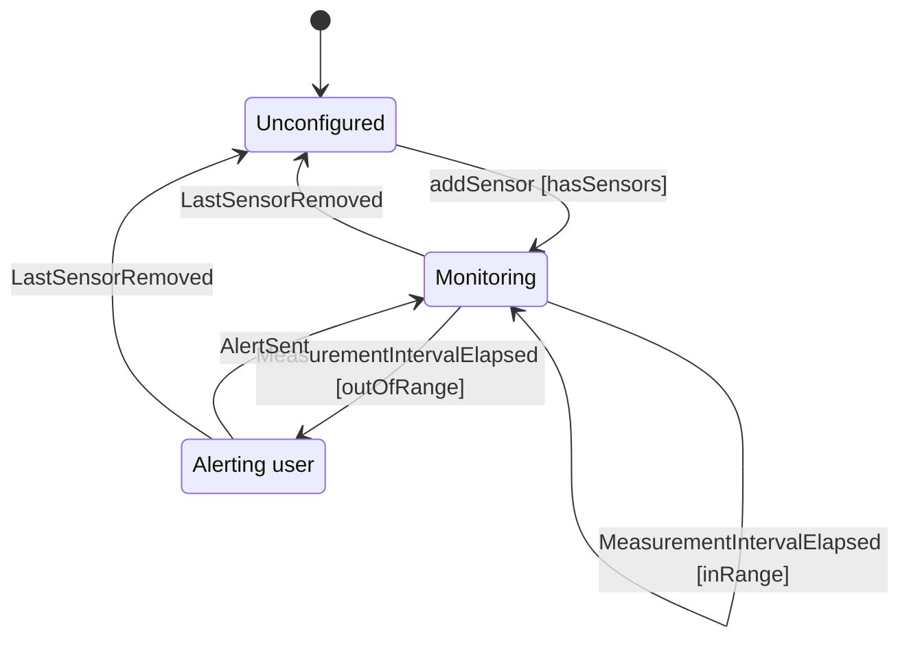
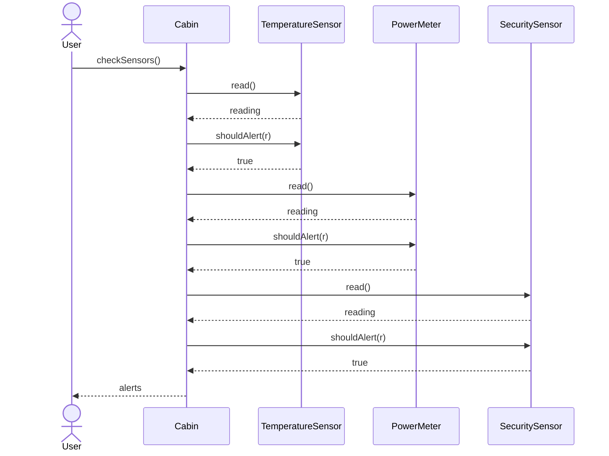

# Cabin monitor: analysis of the revised input set (v3)

**Date:** 2026-10-13 · **Scope:** the five drawings in [`project/diagrams/input/`](../project/diagrams/input/) as of commit `b2f2cb8` · **Status:** exploration complete, implementation not started · **Supersedes:** [v2, 2026-10-09](2026-10-09-cabin-monitor-input-set-analysis-v2.md) (and through it [v1, 2026-09-29](2026-09-29-cabin-monitor-input-set-analysis.md))

This document covers four things:

- what the input set says now;
- where it is still ambiguous, contradictory or incomplete;
- which assumptions the implementation in `project/impl/` has to make;
- how each drawing will be treated as ground truth.

It has the same structure as v2, so the two can be read side by side.

Every parse result quoted here was produced read-only with the repository's own verifier code
(`umlverify.flow_for` and each flow's `drawio_read.read` / `mermaid.write`). It is therefore
exactly what [`tools/verify.py`](../tools/verify.py) will compare an implementation against. The
command is in [§12](#12-how-the-findings-were-produced).

---

## 1. Summary

The system is a **cabin monitoring system**:

- A user owns cabins.
- Each cabin owns temperature, power and security sensors.
- On every measurement interval, the cabin reads each sensor and asks it whether the reading
  must raise an alert. Each sensor type has its own thresholds, which the user can configure.
- The cabin creates one alert per positive answer and returns the alerts.

Since v2, the team applied almost every drawing fix that v2 proposed (commits `fc270d2` and
`12d9295`). All three verifiable drawings now **parse cleanly with no warnings that matter**.

| Diagram | Verdict |
|---|---|
| Class | Parses cleanly: 76 design elements. **74 / 76 ≈ 97 % is reachable as drawn**. The 2 missing points come from `outOfRange()`/`inRange()`, which are drawn returning `void` but must return `bool` because they are guards (C1). Once the drawing says `bool`, it reaches **100 %**. |
| State machine (`state-cabin`) | Parses cleanly: 3 states, 4 events, 6 transitions, plus initial. **100 % is reachable.** The only warning is about the `Deleted cabin` arrow to the end symbol, which is expected and correct. |
| Sequence | Parses cleanly: 7 calls, all attached to lifelines, no fragments. **Not verified yet**, because the file is named `Sequence_diagram.drawio` instead of `sequence-<scenario>.drawio` (C3). |
| Activity, use case | Not verified, because no flow exists for these types. Used as requirements (§8). |

### 1.1 Decisions

**Carried over from v2 (still valid):**

1. **Implement as drawn.** Never edit `project/diagrams/input/`. Every deviation is recorded here
   with its report cost and a one-line drawing fix.
2. **Sensor values and time** come from a **free-function seam** (`hardware.hpp`, no class) that
   tests and scenarios can replace. The class verifier does not compare it, and its calls are
   never traced as messages.
3. **Tests:** doctest, vendored as a single header. They are built only when the CMake option
   `CABIN_BUILD_TESTS` is on.
4. **Namespace and folder:** `namespace cabin`, headers in `include/cabin/`.

**Taken on 2026-10-13, with the user:**

5. **The team renames** `Sequence_diagram.drawio` → `sequence-check_sensors.drawio`. The
   scenario program is written for that name now.
6. **Guards return `bool`.** `outOfRange()` and `inRange()` are implemented as
   `bool … const`, accepting 2 *Changed* in the class report until the drawing is fixed.
   `Flag` becomes an alias, `using Flag = bool;`, where `true` means the last check found
   something out of range. The alias adds no class.
7. **`checkSensors()` fires both events itself.** It fires `MeasurementIntervalElapsed` and,
   once the alerts are built, `AlertSent`. So *Alerting user* lasts only for the moment between
   the two events. `User::alerts_` stays empty until the team adds a way to deliver alerts
   (G1).
8. **A narrow `friend` exception.**
   - `Reading` declares `friend class TemperatureSensor; friend class PowerMeter; friend class SecuritySensor; friend class Cabin;`.
   - `Sensor` declares `friend class Cabin;`.

   With these, the drawn call path reads fields directly instead of calling getters, so it
   makes exactly the 7 drawn calls. The public getters stay for everyone else. Neither verifier
   sees friend declarations.

### 1.2 Most important open items for the team (full list in §11)

- **Alert delivery:** add `+ addAlert(a: Alert): void` to `User`.
- **Drawing fixes:**
  - `outOfRange`/`inRange` → `bool`;
  - `lastCheck: Flag` → `bool`, or draw the alias;
  - rename the sequence file;
  - draw `Deleted cabin` from every state.
- **Values still needed:** the threshold defaults and the severity per alert type.

---

## 2. Inventory and changes since v2

| File | Diagram | Last change | Handled by `tools/verify.py`? |
|---|---|---|---|
| [`class.drawio`](../project/diagrams/input/class.drawio) | Class | `12d9295` | **Yes**, through the class-diagram flow |
| [`state-cabin.drawio`](../project/diagrams/input/state-cabin.drawio) | State machine of `Cabin` | `fc270d2` | **Yes**, through the state flow (owner class `Cabin`) |
| [`Sequence_diagram.drawio`](../project/diagrams/input/Sequence_diagram.drawio) | Sequence | `9b6209d` | **No.** `flow_for()` returns `None` because the stem has no `sequence-` prefix ([umlverify/\_\_init\_\_.py](../tools/umlverify/__init__.py)) |
| [`activity_diagram_2.drawio`](../project/diagrams/input/activity_diagram_2.drawio) | Activity | `9e7e4af` | No (type not supported) |
| [`usecase.drawio`](../project/diagrams/input/usecase.drawio) | Use case | — | No (type not supported) |

**v2 findings now resolved by the team**

| v2 § | Then | Now |
|---|---|---|
| 4.1 | The `cabins` role name sat at the User end | It sits at the far end. Parsed `User *-- "*" Cabin : cabins` ✔ |
| 4.2 | Dependency labelled `creates` | Unlabelled `Cabin ..> Alert` ✔ |
| 4.3 | No state-machine members in the `Cabin` box | `- state: State`, `+ handle(event: Event)`, `+ state(): State`, guards and `- lastCheck: Flag` are drawn ✔ (see C1, C2) |
| 4.4 | No getters | Getters drawn on `Sensor`, `Alert`, `User`, `Cabin`, `Reading` ✔ |
| 5.1 / Q2 | `Sensor --> Reading`, `User --> Alert` (nobody owned them) | Both are **composition** ✔ |
| 6.2 S1 | Choice diamond | Replaced by two guarded arrows `[outOfRange]` / `[inRange]` ✔ |
| 6.2 S2 | Guards `sensors > 0` / `sensors == 0` | `[hasSensors]`. The remove arrows are now the event `LastSensorRemoved`, with no guard ✔ |
| 7.3 Q-2…Q-4 | Free arrow endpoints, `alt` fragments, `create` messages | All arrows attached, no fragments, no `create` ✔ |
| 7.3 Q-1 | File name | **Still open** (C3) |

New since v2:

- `Sensor` gained `getReadings(): Reading[]`.
- The state machine gained `Alerting user --LastSensorRemoved--> Unconfigured`.
- The sequence diagram is drawn on the "all three sensors alert" path.

---

## 3. Class diagram as the verifier reads it

### 3.1 Parsed design



**The design has 76 elements:**

| Kind | Count | Breakdown |
|---|---:|---|
| Classes | 9 | |
| Attributes and literals | 21 | 18 attributes, 3 enum literals |
| Methods | 38 | |
| Relations | 8 | |

### 3.2 C++ mapping

| Design | C++ in `include/cabin/` | Why it matches |
|---|---|---|
| `Sensor` «abstract» | `virtual Reading read() = 0; virtual bool shouldAlert(const Reading& r) const = 0;` plus `id_`, `name_`, and a virtual destructor | Abstract means at least one pure-virtual method **and** at least one data member ([mapping](../tools/umlverify/docs/UML-CPP-MAPPING.md#classifiers)) |
| `Sensor <\|-- X` | `class TemperatureSensor : public Sensor` (and likewise for the others) | The base has data members, so this is inheritance |
| `Sensor *-- "*" Reading : readings` | `protected: std::vector<Reading> readings_;` | By-value vector = composition, `*`. **Protected** so that each subclass's `read()` can append. Relations carry no visibility in the comparison ([elements.py L90-104](../tools/umlverify/class_diagram/elements.py#L90-L104)), so this costs nothing |
| `Cabin *-- "*" Sensor : sensors` | `std::vector<std::unique_ptr<Sensor>> sensors_;` | Sensors are polymorphic, so a `unique_ptr` is needed rather than a by-value member |
| `User *-- "*" Cabin : cabins` | `std::vector<std::unique_ptr<Cabin>> cabins_;` | Keeps `Cabin*` handed out by `getCabins()` stable when cabins are added |
| `User *-- "*" Alert : alerts` | `std::vector<Alert> alerts_;` | |
| `Cabin ..> Alert` | no member; `std::vector<Alert> checkSensors();` | A dependency appears only in a signature |
| `addSensor(s: Sensor)` | `void addSensor(std::unique_ptr<Sensor> s);` | A top-level `unique_ptr<T>` normalizes to `T` |
| `addCabin(c: Cabin)` | `void addCabin(std::unique_ptr<Cabin> c);` | Same rule |
| `getSensors(): Sensor[]` | `std::vector<Sensor*> getSensors() const;` | See the warning below |
| `getCabins(): Cabin[]` | `std::vector<Cabin*> getCabins() const;` | Same warning |
| `getReadings(): Reading[]`, `getAlerts(): Alert[]` | `const std::vector<Reading>& getReadings() const;` and the same shape for alerts | `const` and `&` are dropped, so this normalizes to `list<Reading>`; it also avoids a copy |
| `shouldAlert(r: Reading): bool` | `bool shouldAlert(const Reading& r) const` | `const T&` is fine, and the trailing `const` is not compared |
| `String` | `std::string` | Type names compare case-insensitively ([elements.py `ntype`](../tools/umlverify/class_diagram/elements.py#L30-L38)) |
| `DateTime` | `using DateTime = std::chrono::sys_seconds;` in `date_time.hpp` | An alias is not a class declaration, so no extra class. *Risk:* see §3.3 |
| `Flag` | `using Flag = bool;` in `flag.hpp` | Decision 6. Same risk |
| `- state: State` | `State state_ = State::Unconfigured;` | The state-machine pattern ([door.hpp](../examples/3-state-simple/impl/include/home/door.hpp)) |
| `state(): State` | `State state() const;` | The method `state` and the attribute `state_` are different categories, so they do not collide |
| `Severity` | `enum class Severity { LOW, MEDIUM, HIGH };` | |

> **Correction to v2 §3.3.** v2 proposed
> `const std::vector<std::unique_ptr<Sensor>>& getSensors() const`. That does **not** match
> `Sensor[]`.
>
> - `ntype` strips `unique_ptr<…>` only at the outermost level
>   ([elements.py L35-36](../tools/umlverify/class_diagram/elements.py#L35-L36)). The vector is
>   rewritten to `list<unique_ptr<Sensor>>` first, and the inner `unique_ptr` stays.
> - The result normalizes to `listuniqueptrsensor`, while the design normalizes to `listsensor`.
>
> Return `std::vector<Sensor*>` instead: the `*` is stripped, which gives `list<Sensor>`.
> It costs one small allocation per call. That is acceptable: `getSensors()` is not on the hot
> path, and `checkSensors()` iterates `sensors_` directly.

### 3.3 Things to confirm on the first verifier run

- **Alias spelling.** For `DateTime time_` and `Flag lastCheck_`, libclang should report the
  field type as written (`DateTime`, `Flag`), not as the underlying type. If it reports
  `std::chrono::…` or `bool` instead, the report shows 4 *Changed* (`Reading.time`,
  `Alert.time`, `Cabin.lastCheck`, plus the getters' return types).
  - *Fallback:* the team writes `bool` for `lastCheck`. For `DateTime`, use a thin alias whose
    spelling is preserved, or accept the difference and note it.
- **Friends are invisible.** `friend class …;` declarations must not show up as classes or
  relations. Expected, because `collect()` only takes namespace-level *definitions*
  ([cpp_extract.py L89-102](../tools/umlverify/class_diagram/cpp_extract.py#L89-L102)).

### 3.4 Expected alignment

| | As drawn (decisions 1–8) | After drawing fix C1 |
|---|---:|---:|
| Identical | 74 | 76 |
| Changed | 2 (`Cabin.outOfRange`, `Cabin.inRange`: return type) | 0 |
| Missing / Extra | 0 / 0 | 0 / 0 |
| **Alignment** | **≈ 97.4 %** | **100 %** |

---

## 4. Remaining conflicts and gaps

### 4.1 Conflicts between drawings, or between a drawing and the verifier

Each conflict has evidence, a plan, a report cost and a drawing fix.

#### C1. `outOfRange()` / `inRange()` are drawn as actions but used as guards

- **Evidence.** The class box draws `- outOfRange(): void` and `- inRange(): void`. The state
  diagram uses `[outOfRange]` and `[inRange]` as guards.
- **Why it matters.** The table's guard field is `bool (Cabin::*)() const`. The state extractor
  decides guard or action *by return type*
  ([mapping, "What the extractor reads back"](../tools/umlverify/docs/UML-CPP-MAPPING.md#state-machines)).
  A `void` method cannot be a guard.
- **Plan.** `bool outOfRange() const;` and `bool inRange() const;`.
- **Cost.** 2 *Changed* in `class-report.md`. The state report is unaffected.
- **Fix.** Change both lines in the `Cabin` box to `: bool`.

#### C2. `Flag` is not defined

- **Evidence.** `- lastCheck: Flag`. No class, enumeration or note defines `Flag`.
- **Plan.** `using Flag = bool;` (decision 6). The flag holds the outcome of the last
  `checkSensors()`: `true` means at least one sensor was out of range. `outOfRange()` returns the
  flag, and `inRange()` returns its negation.
- **Cost.** None, if the alias spelling survives (§3.3).
- **Fix.** Write `- lastCheck: bool`, or draw `Flag` if it is meant to become a richer type.

#### C3. Sequence file name

- **Evidence.** `flow_for('Sequence_diagram.drawio')` returns `None`. The verifier lists only
  `sequence-<scenario>.drawio`.
- **Plan.**
  - The team renames the file to `sequence-check_sensors.drawio` (decision 5).
  - `impl/scenarios/check_sensors.cpp` and `add_executable(scenario_check_sensors …)` are
    written now.
- **Cost.** No sequence report until the file is renamed.
- **Fix.** `git mv project/diagrams/input/Sequence_diagram.drawio project/diagrams/input/sequence-check_sensors.drawio`.

### 4.2 Design gaps

These are not verifier conflicts. They are places where the drawings do not say enough to
implement the design well.

| # | Gap | Plan / assumption |
|---|---|---|
| G1 | **Nothing adds alerts to a `User`.** `User *-- "*" Alert : alerts` exists, but `User` has no `addAlert`. `checkSensors()` returns the alerts to whoever called it. | `alerts_` exists and `getAlerts()` returns it, but it stays empty (decision 7). This is documented in `user.hpp`. *Recommended fix:* draw `+ addAlert(a: Alert): void`, then the caller of `checkSensors()` delivers the alerts. |
| G2 | `noSensors()` is drawn, but no transition uses it. `LastSensorRemoved` is an event, not a guard. | `removeSensor(id)` removes the sensor, then fires `LastSensorRemoved` only when `noSensors()` holds. |
| G3 | `Deleted cabin` → final state is drawn only from `Unconfigured`. The verifier skips it (a terminal state needs no row). | `User::removeCabin(id)` works in **any** state and destroys the cabin. Destruction needs no event (A8). *Fix:* draw it from every state, or confirm that cabins with sensors may not be deleted. |
| G4 | *Alerting user* has no row for `MeasurementIntervalElapsed`, `addSensor` or `AlertSent` from elsewhere. | Moot under decision 7: `AlertSent` fires inside the same `checkSensors()` call, so a cabin is never left in *Alerting user* between calls. |
| G5 | `read()` takes no input. Where does a value come from? | Free-function seam: `cabin::hardware::sample(sensorId)`, replaceable through `setSampler(...)`. The default is a deterministic simulated source. |
| G6 | `Reading.time` and `Alert.time` need a clock, but scenarios must not use one. | `cabin::hardware::now()`: a simulated clock that starts at a fixed epoch and advances 1 min per call. Replaceable through `setClock(...)`. |
| G7 | Who assigns `Alert.id`? | A per-cabin counter, starting at 1, in creation order (A6). It lives in `cabin.cpp` as a per-object map keyed by `this`, because a counter member would be an undrawn attribute. *Fix option:* draw `- nextAlertId: int`. |
| G8 | Which severity for which alert? | A5. |
| G9 | What does the alert message say? | `"<sensor name>: <kind> (<value> <unit>)"`. The kind is *temperature high*, *temperature low*, *consumption* or *intrusion* (A7). Cabin reads the name and value through friendship (decision 8). |
| G10 | `removeSensor(id)` / `removeCabin(id)` with an unknown id | A no-op, documented (A8). |
| G11 | Duplicate sensor or cabin ids | `std::invalid_argument` (A9). |
| G12 | `setThreshold(min, max)` with `min > max` | `std::invalid_argument` (A10). |
| G13 | `PowerMeter` has one `threshold`, but the activity diagram says "outside limits" | Upper limit only (A3). |
| G14 | `SecuritySensor` has no threshold | Alert when the value is not `0` (movement / door open) (A3). |
| G15 | Reading history grows without bound | Bounded to 1 000 readings per sensor; the oldest is evicted first (A13). Enforced in `read()`. |
| G16 | Login and notification (use case) | Out of scope for the core. There are no operations for them in the class diagram (§8). |

---

## 5. State machine: `state-cabin.drawio` (owner `Cabin`)

### 5.1 Parsed



There is one warning, and it is expected: *the transition 'Deleted cabin' from 'Unconfigured' to
the end symbol has no C++ counterpart; skipped.*

### 5.2 Planned table

This follows the pattern in [door.hpp](../examples/3-state-simple/impl/include/home/door.hpp).

```cpp
enum class State { Unconfigured, Monitoring, AlertingUser };
enum class Event { addSensor, LastSensorRemoved, MeasurementIntervalElapsed, AlertSent };

// guards, declared before the table
bool hasSensors() const;
bool noSensors() const;
bool outOfRange() const;   // C1: bool, drawn as void
bool inRange() const;

State state_ = State::Unconfigured;
Flag  lastCheck_ = false;

struct Transition { State from; Event event; State to;
                    bool (Cabin::*guard)() const; void (Cabin::*action)(); };
static constexpr Transition transitions[] = {
    {State::Unconfigured, Event::addSensor,                  State::Monitoring,   &Cabin::hasSensors, nullptr},
    {State::Monitoring,   Event::LastSensorRemoved,          State::Unconfigured, nullptr,            nullptr},
    {State::Monitoring,   Event::MeasurementIntervalElapsed, State::AlertingUser, &Cabin::outOfRange, nullptr},
    {State::Monitoring,   Event::MeasurementIntervalElapsed, State::Monitoring,   &Cabin::inRange,    nullptr},
    {State::AlertingUser, Event::AlertSent,                  State::Monitoring,   nullptr,            nullptr},
    {State::AlertingUser, Event::LastSensorRemoved,          State::Unconfigured, nullptr,            nullptr},
};
```

Notes on the table:

- The event enumerator `addSensor` shares its name with the method `addSensor()`. That is
  harmless, because the enum is scoped.
- `handle(Event)` takes the first row whose state and event match and whose guard holds (or that
  has no guard). An event with no row is ignored.

### 5.3 Who fires which event

| Event | Fired by |
|---|---|
| `addSensor` | `Cabin::addSensor()`, after storing the sensor |
| `LastSensorRemoved` | `Cabin::removeSensor()`, after erasing, when `noSensors()` (G2) |
| `MeasurementIntervalElapsed` | `Cabin::checkSensors()`, after evaluating every sensor and setting `lastCheck_` (A12) |
| `AlertSent` | `Cabin::checkSensors()`, right after the event above, when alerts were produced (decision 7) |

All of these are calls of `Cabin`'s own methods, so the sequence trace does not count them (§6).

### 5.4 Expected alignment

| Element | Count |
|---|---:|
| States | 3 |
| Events | 4 |
| Initial state | 1 |
| Transitions | 6 |
| **Total** | **14** |

All 14 are expected to be identical, which gives **100 %**.

---

## 6. Sequence diagram: `Sequence_diagram.drawio` → `sequence-check_sensors.drawio`

### 6.1 Parsed



- There are **7 compared calls**. Return arrows are not compared.
- The note *"For each sensor where shouldAlert(r) returned true, Cabin creates an Alert"* is
  documentation. Alert construction is a constructor call, which is never a message.

### 6.2 Planned scenario

`impl/scenarios/check_sensors.cpp`, copied from
[set_target.cpp](../examples/5-sequence-simple/impl/scenarios/set_target.cpp):

- `main()` does the setup:
  - creates a `Cabin` and adds, in drawing order, a `TemperatureSensor`, a `PowerMeter` and a
    `SecuritySensor`;
  - sets the seam to fixed out-of-range samples: 40 °C, 10 kWh, and `1` (movement);
  - then calls `scenario(cabin)`.
- `void scenario(cabin::Cabin& cabin) { cabin.checkSensors(); }` makes the actor's single call.
- The scenario is deterministic: a simulated clock, fixed samples and a single thread.

### 6.3 Rules that keep the trace exactly as drawn

The traced build uses `-finstrument-functions -O0`, so **every** call between project classes is
recorded, inline getters included.

| Risk | Handling |
|---|---|
| `shouldAlert(r)` calling `r.getValue()` would add `Sensor → Reading : getValue` ×3 | Friendship (decision 8): reads `r.value_` directly |
| `checkSensors()` calling `sensor->getName()` / `reading.getValue()` / `getTime()` to build the alert would add extra messages | Friendship: reads `name_`, `value_` and `time_` directly |
| `checkSensors()` calling `handle()`, `outOfRange()`, `inRange()` | Calls of Cabin's own methods. Not counted unless drawn ([trace rules](../tools/umlverify/docs/UML-CPP-MAPPING.md#sequence-diagrams)) |
| `read()` constructing a `Reading`; `checkSensors()` constructing an `Alert` | Constructors are never messages |
| `hardware::sample()` / `hardware::now()` | Free functions are never messages |
| The receiver name | Each subclass overrides `read()` and `shouldAlert()`, so the receiver is recorded as `TemperatureSensor` and so on. A method inherited from `Sensor` would be recorded as `Sensor` |
| The actor `User` is also a class name | Calls from `scenario()` are attributed to the initiator `User` ([trace_extract.py L74](../tools/umlverify/sequence_diagram/trace_extract.py#L74)). The `User` class is not used in the scenario |

**Expected:** 7 / 7 calls, **100 %**, once C3 is resolved.

---

## 7. Cross-diagram consistency

✔ defined · ◐ implied / named differently · ✘ absent

| Concept | Class | State | Sequence | Activity | Use case |
|---|:-:|:-:|:-:|:-:|:-:|
| User | ✔ | ✘ | ✔ actor | ◐ "user" | ✔ |
| Cabin | ✔ | ✔ owner | ✔ | ✘ | ✘ |
| Three sensor types | ✔ | ◐ "sensor" | ✔ | ✔ | ◐ |
| Reading | ✔ composition | ✘ | ◐ return `reading` | ◐ "read" | ◐ "sensor values" |
| Thresholds | ✔ per sensor | ◐ guards | ◐ `shouldAlert` | ✔ | ✔ |
| Alert | ✔ composition in User | ◐ *Alerting user* | ◐ return `alerts` | ✔ 3 kinds | ◐ |
| Alert kind | ✘ (`message` only) | ✘ | ✘ | ✔ | ✘ |
| Alert delivery to User | ◐ `alerts` without add | ◐ `AlertSent` | ◐ return | ◐ "return alerts" | ✔ notification |
| Measurement interval | ✘ | ✔ event | ✘ | ✘ | ◐ |
| Login | ✘ | ✘ | ✘ | ✘ | ✔ |

The verifiable diagrams are now mutually consistent. The remaining holes are alert delivery
(G1), alert kind (A7), and login and notification (G16).

---

## 8. Activity and use-case diagrams (requirements only)

**Activity** (`activity_diagram_2.drawio`) is a sequential flow:

1. Read temperature sensor → *Temperature outside user's limits?* → if yes, generate a high or
   low temperature warning.
2. Read power meter → *Energy use outside limits?* → if yes, generate a consumption warning.
3. Read security sensor → *Is there any movement?* → if yes, generate an intrusion warning.
4. Return alerts to user.

This matches `checkSensors()` and the sequence order T, P, S. It defines the three alert kinds
(A7) and the rule "outside *user's* limits", which means configurable thresholds.

**Use case** (`usecase.drawio`):

- Actor: User.
- Use cases: *Log in*, *Manage sensors*, *View sensor values*, *View monitoring dashboard*,
  *Configure threshold limits*, *Monitor system metrics*, and *send notification* with
  `«extend» [threshold exceeded]`.
- Note: authentication is required for everything else.

| Use case | Covered by |
|---|---|
| Manage sensors | `Cabin::addSensor/removeSensor/getSensors` |
| View sensor values | `Sensor::getReadings`, `Reading` getters |
| Configure threshold limits | `TemperatureSensor::setThreshold(min,max)`, `PowerMeter::setThreshold(t)` |
| Monitor system metrics | `Cabin::checkSensors()` and the state machine |
| View dashboard | `User::getCabins/getAlerts` (the UI itself is out of scope) |
| Log in, send notification | **Not covered** (G16, G1) |

**Drawing notes still open from v2:**

- U-1: write `«extend»` with guillemets. `<<extend>>` is stripped as an HTML tag.
- U-2: the extend arrow should point from *send notification* to *Monitor system metrics*.

---

## 9. Proposed architecture and quality plan

```
project/impl/
  CMakeLists.txt         C++20, CMAKE_EXPORT_COMPILE_COMMANDS ON, static lib "cabin" from src/*.cpp,
                         include/ public, -Wall -Wextra; demo; scenario_check_sensors;
                         option(CABIN_BUILD_TESTS OFF) -> tests/ (doctest, CTest)
  include/cabin/
    sensor.hpp  temperature_sensor.hpp  power_meter.hpp  security_sensor.hpp
    reading.hpp  alert.hpp  user.hpp  cabin.hpp  severity.hpp
    date_time.hpp        using DateTime = std::chrono::sys_seconds;     (alias, no class)
    flag.hpp             using Flag = bool;                             (alias, no class)
    hardware.hpp         free functions: sample(id), now(), setSampler(), setClock(), reset()
  src/                   one .cpp per class with code, hardware.cpp, demo.cpp
  scenarios/check_sensors.cpp
  tests/
    third_party/doctest.h            vendored, pinned version, licence kept
    test_reading.cpp test_alert.cpp test_temperature_sensor.cpp test_power_meter.cpp
    test_security_sensor.cpp test_cabin.cpp test_cabin_state.cpp test_user.cpp test_hardware.cpp
```

Patterns to copy:

- CMake: [examples/1-class-simple/impl/CMakeLists.txt](../examples/1-class-simple/impl/CMakeLists.txt)
- State table: [door.hpp](../examples/3-state-simple/impl/include/home/door.hpp)
- Scenario: [set_target.cpp](../examples/5-sequence-simple/impl/scenarios/set_target.cpp)

| Concern | Approach |
|---|---|
| Structure | The AGENTS.md layout: one class per header, `snake_case` files, `namespace cabin`. No undrawn classes; helpers are in `src/` as `static` / anonymous-namespace functions. |
| Documentation | A Doxygen comment on every public member covering pre- and postconditions, ownership, units, and the documented deviations (C1, G1, decision 8). Also `project/impl/README.md`, specs in `project/process/specs/` and plans in `project/process/plans/`. |
| Unit tests | **Every class:** construction and getters. **Sensors:** `read()` stores and returns, and `shouldAlert()` is tested at, just inside and just outside every limit. **Validation:** `setThreshold` rejects bad input. **Collections:** add, remove, duplicate and unknown ids; ownership transfer. **History:** the bound evicts the oldest reading first. |
| State tests | One test per table row; each guard both true and false; an event with no row is ignored; the initial state. |
| `checkSensors()` tests | No alerts, each single alert, all three alerts. Checks the alert ids, severities, messages and simulated times, and the state after the call. |
| Coverage | gcovr: **100 % line and branch coverage** of `src/`, excluding `demo.cpp`. |
| Warnings | `-Wall -Wextra` in the verified build (AGENTS.md). Tests and CI add `-Wpedantic -Werror`. |
| Sanitizers | An ASan + UBSan configuration for the test run. |
| Performance | `checkSensors()` is O(sensors), with one `reserve` and iteration over `sensors_` directly. `handle()` walks a `constexpr` table with no allocation. Readings are contiguous in a bounded history. Getters return `const&` where the signature allows. |
| CI | GitHub Actions running build, tests, coverage and `tools/verify.py project`, with the reports kept as artifacts. |

---

## 10. Environment

- Python is available. There is **no `.venv`** yet; the VS Code task *Set up Python environment*
  creates it.
- **No C++ toolchain on PATH** (no `cmake`, `g++`, `clang`, `ninja`). On its first run the
  verifier installs **MSYS2 UCRT64** (gcc, cmake, ninja, nm, c++filt) through winget
  ([toolchain.py](../tools/umlverify/core/toolchain.py)). Expect a download of about 1 GB.
- The class and state flows need `libclang` (from [requirements.txt](../requirements.txt)). The
  sequence flow needs the traced build.

---

## 11. Assumptions and open questions

### 11.1 Assumptions

| # | Assumption | Why |
|---|---|---|
| A1 | `DateTime` = `std::chrono::sys_seconds` (UTC, whole seconds), as an alias | Standard, comparable, and adds no class |
| A2 | Units: temperature in °C; power in kWh consumed in the interval; security `0` = quiet, `1` = movement / door open | The activity-diagram wording; `value: double` holds all three |
| A3 | Alert rules: temperature `< min` or `> max`; power `> threshold`; security `!= 0`. Limits are exclusive (a value exactly at a limit does not alert) | The activity diagram; `PowerMeter` has one threshold |
| A4 | Default thresholds: temperature **5 °C … 30 °C**, power **3 kWh per interval** | Placeholders, changeable through `setThreshold` |
| A5 | Severity: intrusion **HIGH**; temperature below 0 °C **HIGH**, otherwise outside limits **MEDIUM**; consumption **LOW** | Damage first, cost last |
| A6 | Alert ids are per cabin, starting at 1, in creation order | Deterministic and testable |
| A7 | The alert kind (temperature high/low, consumption, intrusion) is written into `message` | There is no `kind` attribute in the design |
| A8 | Unknown ids in `remove*` do nothing; `removeCabin` is allowed in any state | Simplest total behaviour (G3, G10) |
| A9 | Duplicate ids are rejected with `std::invalid_argument` | `remove*(id)` needs unique ids |
| A10 | `setThreshold(min, max)` with `min > max` is rejected | A contradictory limit would alert on every value |
| A11 | The sequence actor `User` is the person, not the `User` class | Calls from `scenario()` belong to the actor |
| A12 | One `checkSensors()` call is one measurement interval | There is no timer in the model |
| A13 | Reading history is bounded to 1 000 readings per sensor, oldest evicted first | Keeps memory bounded |
| A14 | `checkSensors()` on a cabin without sensors returns no alerts. The event is ignored in `Unconfigured` (no row) | As drawn |

### 11.2 Open questions for the team

Each question has a recommended answer. The implementation uses that answer until the team
decides otherwise.

1. **How do alerts reach a `User`?** *Recommended:* draw `+ addAlert(a: Alert): void` on `User`.
   Until then `alerts_` stays empty (G1).
2. **Drawing fixes, to reach 100 % everywhere:**
   - `Cabin`: `- outOfRange(): bool`, `- inRange(): bool` (C1);
   - `- lastCheck: bool`, or keep `Flag` and confirm the alias (C2);
   - rename the sequence file to `sequence-check_sensors.drawio` (C3);
   - optionally `- nextAlertId: int` on `Cabin` (G7).
3. **Can a cabin be deleted while it has sensors?** *Recommended:* yes. Draw `Deleted cabin` from
   every state (G3).
4. **Threshold defaults, and does `PowerMeter` need a lower limit?** *Recommended:* A4, upper
   limit only.
5. **Severity per alert, and should `Alert` get a `kind`?** *Recommended:* A5, and add
   `- kind: AlertKind` if the dashboard needs to filter by kind.
6. **How much reading history should be kept?** *Recommended:* A13.
7. **Is login or notification in scope?** *Recommended:* out of scope for the core library.
8. **Use-case drawing:** `«extend»` with guillemets, and reverse the arrow (U-1, U-2).

---

## 12. How the findings were produced

From the repository root, read-only (nothing is written):

```sh
cd tools
python -I -c "import sys; sys.path.insert(0,'.'); import umlverify
from umlverify.class_diagram import drawio_read as c, mermaid as cm
from umlverify.state_diagram import drawio_read as s, mermaid as sm
from umlverify.sequence_diagram import drawio_read as q, mermaid as qm
P='../project/diagrams/input/'
for f in ['class','state-cabin','Sequence_diagram','usecase','activity_diagram_2']: print(f, umlverify.flow_for(P+f+'.drawio'))
r=c.read(P+'class.drawio'); print(cm.write(r[0], r[1]))
r=s.read(P+'state-cabin.drawio'); print(sm.write(r[0]), r[1:])
r=q.read(P+'Sequence_diagram.drawio'); print(qm.write(r[0]), r[1:])"
```

The activity and use-case contents were read from the raw `mxCell` labels. The normalization,
relation and trace rules were read from these files:

- [UML-CPP-MAPPING.md](../tools/umlverify/docs/UML-CPP-MAPPING.md)
- [class_diagram/elements.py](../tools/umlverify/class_diagram/elements.py)
- [class_diagram/cpp_extract.py](../tools/umlverify/class_diagram/cpp_extract.py)
- [sequence_diagram/trace_extract.py](../tools/umlverify/sequence_diagram/trace_extract.py)
